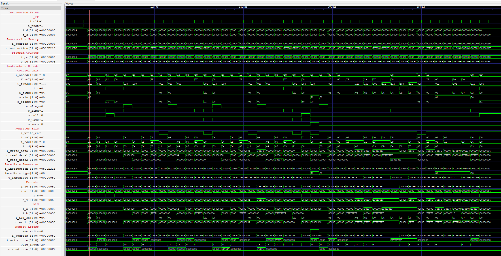
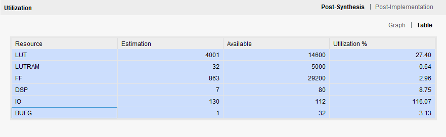

# RISC‑V Single‑Cycle CPU

Synthesizable RV32I + RV32M single-cycle CPU built in VHDL. Implements integer arithmetic, logic, shifting, multiplication/division, and memory/branch/jump instructions. Includes instruction memory, data memory, control unit, and complete datapath.

## Overview
- **ISA**: RV32I + RV32M (Integer base + Multiply/Divide).
- **Execution**: Single-cycle datapath — fetch, decode, execute, memory, and write-back occur in one clock cycle.
- **Control**: Centralized Control Unit decodes instructions into datapath control signals.
- **Datapath**: Register file, ALU, Immediate Generator, branch/jump address calculators, muxes, and PC logic.
- **Memory**: Separate instruction and data memories (Harvard architecture).
- **Branching**: Supports BEQ, BNE, BLT, BGE, JAL, and JALR.

## Top Module 
The top-level instantiates : 
- ```RISC_V_SingleCycle_Core.vhd``` - CPU core (Control + Datapath).
- ```InstructionMemory``` - Read-only, preloaded with a program.
- ```DataMemory``` - Read/Write data storage.

```bash 
entity RISC_V_SingleCycle_Computer is
    port (
        i_clk  : in  std_ulogic;
        i_nrst : in  std_ulogic;
        o_instr : out std_ulogic_vector(31 downto 0);
        o_pc    : out std_ulogic_vector(31 downto 0);
        o_alu   : out std_ulogic_vector(31 downto 0);
        o_mem   : out std_ulogic_vector(31 downto 0)
    );
end entity;
```
## Single Cycle Stages 
1. *Fetch* — From PC, get instruction from InstructionMemory, also compute PC+4.
2. *Decode* — Control Unit sets control signals; register file reads rs1, rs2; Immediate Generator produces immediate.
3. *Execute* — ALU performs operation or address calculation. Operand B comes from reg2 or immediate via mux.
4. *Memory* — If load/store, access DataMemory with address from ALU and data from rs2.
5. *Write-back* — Mux selects ALU/data memory/PC+4 for writing into rd register.
6. *PC Update* — Mux4 chooses next PC (PC+4, branch, JAL, JALR).

## Simulate & View (GHDL + GTKWave)
This repo includes a one‑shot script that:
- Compiles and runs the TB with GHDL
- Dumps .ghw for GTKWave and .vcd for power analysis
- Opens GTKWave

## Prerequisites
- GHDL, GTKWave, Python 3

## Run 
``` bash 
./sim/compSim.sh
```
## Output 

## Hardware Utilization 
- Synthesized the design on Xilinx Vivado, the design is not optimized for I/O.

